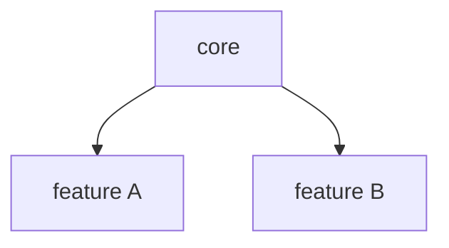

# Architecture and Technical Design: <product name>

> Stage NP6 · Status: DRAFT | APPROVED <date-time> · Standard: `.agents/skills/project-architecture/SKILL.md`
> Inputs: requirements, integration plan, `questions.md` round 5

## 1. Summary
- <standard applied, key decisions, main risks>

## 2. Standard applied
- Standard: <Flutter house standard · native Android · native iOS · generic (written in this stage)>
- Approved deviations (each with a reason and an ADR): …

## 3. Tech stack
| Layer | Choice | Version | Why |
|---|---|---|---|

## 4. Modules and features
| Feature folder | Responsibility | Screens | Depends on | Stories |
|---|---|---|---|---|

## 5. Navigation map
| Route constant | Path | Screen | Data passed | Guard (e.g. logged in) |
|---|---|---|---|---|

## 6. State management
| Feature | State holders (provider / view model) | Type | Lifetime (auto-dispose?) | Owned data |
|---|---|---|---|---|
- Global state (user, settings, premium status): …

## 7. Data model and storage
| Entity | Fields | Source | Stored where (API · Hive box · SharedPreferences key · database table) |
|---|---|---|---|

## 8. Networking
- Base URLs per environment · HTTP client · interceptors · standard headers
- Error mapping (timeouts, 401, 5xx) · token refresh

## 9. Security
- Token storage · secrets handling · obfuscation · permissions · data at rest · logging policy (no personal data)

## 10. Non-functional design
- Performance · offline · accessibility · localization · responsive layout (design size) · app size

## 11. Project-specific values
| Item | Value |
|---|---|
| App name | |
| Package / bundle id | |
| Organization (reverse domain) | |
| Design size (width × height) | |
| Font family | |
| Brand colors | |
| Flavors | |

## 12. Decisions (ADRs)
| ADR | Title | Status |
|---|---|---|

## 13. Open items
- …

---
**Ready to approve?** ☐ every feature from the requirements has a module ☐ every screen has a route ☐ state
ownership is clear ☐ storage and security decided ☐ deviations have ADRs ☐ no [OPEN-BLOCKING] item
