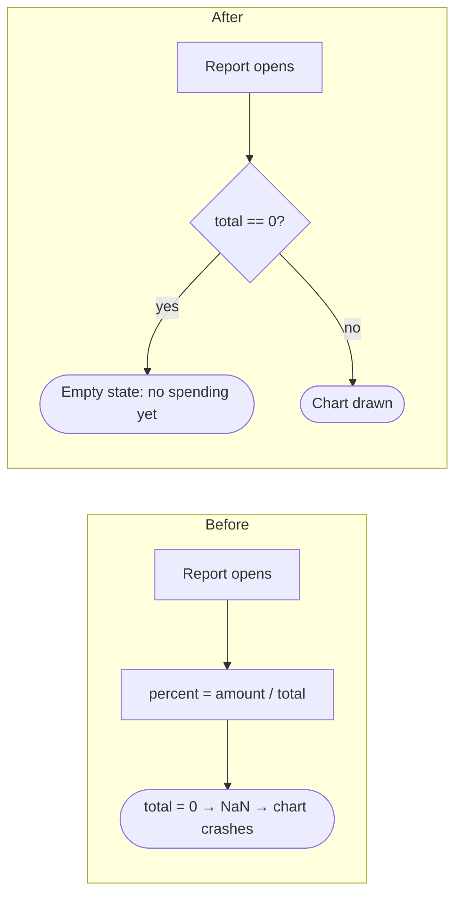

# Bug-fix Plan: <work item id> · <title>

> Status: DRAFT | APPROVED <date-time> | COMPLETED <date-time>
> Severity: critical | high | medium | low · Reported by / where: …
> 🛑 No code is changed until the user explicitly approves this plan.

## Thinking summary
<!-- From .agents/skills/aidlc-think/SKILL.md. Keep it short. -->
- Depth: full | light (reason)
- Lessons applied: <ID (how)> · not applicable: <ID (why)>
- Research: <R-ID (topic)> | not needed (reason)
- Options: A … (score) · B … (score) → chosen: …, because …
- Pre-mortem: 1) <risk> → <mitigation> 2) …
- Self-review changes: …
- Verification: <n> facts verified · <n> assumptions (listed at the gate) · 0 unknown · verify-plan.sh ✓

## Facts and assumptions
<!-- Anti-hallucination (.agents/rules/50-anti-hallucination.md): every fact this plan depends on, with the
     evidence you saw in this session (path:line, command output, URL, the user's words).
     Status: verified · assumption (listed at the gate) · unknown (find it or ask the user before the gate).
     `bash ~/.aidlc-kit/verify-plan.sh <this file>` checks this table. -->
| # | Claim the plan depends on | Evidence | Status |
|---|---|---|---|
| F1 | <e.g. `ReportChart` divides by `total`> | <`lib/features/report/report_chart.dart:42`> | <verified> |

## 1. Symptom
- Expected: …
- Actual: …
- Must not change: … (the behaviour around the bug that stays the same, and the tests that prove it)

## 2. Reproduction
- Steps: 1. … 2. … 3. …
- Environment: device · OS version · app version and build · account type
- Reproduced: yes (how) | no (what is missing)

## 3. Root cause
- Where: `path/to/file:line`
- Why it happens: the exact condition
- Since when: version or commit, if known

## 4. Blast radius
- Other callers of this code: …
- The same bug pattern elsewhere (found by searching): … (fixed here only if the user agrees)

<!-- aidlc:files:begin · only files listed in the two tables below may be changed after approval. Only the Path column counts: one or more full paths in backticks per row. Backticks in other columns never add files. -->
## 5. Files to create
| # | Path | Purpose |
|---|---|---|
| C1 | `test/…/<name>_test.dart` | Regression test |

## 6. Files to modify
| # | Path | What changes |
|---|---|---|
<!-- aidlc:files:end -->

## 7. Fix approach
The smallest change that fixes the root cause (not just the symptom). Alternatives considered and why not.

**Before and after** (draw the real code path; example below):

## 8. Regression test
A test that fails before the fix and passes after it. If it cannot be automated: the manual check and why.

## 9. Verification
Commands from the project profile; pass criteria as in `10-quality-gates.md` §4.

## 10. Risk and rollback
| Risk | Mitigation |
|---|---|
Rollback: …

## 11. Task plan
<!-- Under every task: How (file, change, key code shape), Why (the root cause or rule), Check (the proof). -->
### Phase 1: Regression test
- [ ] ⏳ **[PENDING]** T1 Write the regression test and confirm that it fails
  - How: `test/…/<name>_test.dart` builds the failing case from §2 (e.g. total = 0)
  - Why: proves the root cause in §3 and guards against it coming back
  - Check: the test fails before the fix, with the error from §1
### Phase 2: Fix
- [ ] ⏳ **[PENDING]** T2 Apply the fix
  - How: … (the change at `path:line`, as in the "After" diagram)
  - Why: … (the exact condition from §3)
  - Check: the regression test passes; nothing else changes behaviour
### Phase 3: Verification
- [ ] ⏳ **[PENDING]** Regression test passes
- [ ] ⏳ **[PENDING]** Review and gap analysis
- [ ] ⏳ **[PENDING]** Full verification and completion report

## 12. Plan changes (after approval)
| ID | Date-time | File and change | Reason | Status |
|---|---|---|---|---|

---
**Ready to approve?** ☐ root cause has file:line evidence ☐ the fix targets the cause ☐ a regression test is
planned ☐ blast radius checked ☐ no behaviour change beyond the bug ☐ the example rows are replaced
☐ the before/after diagram shows the real code path ☐ every task has How, Why and Check
☐ what must not change is stated and tested ☐ no fact is "unknown" (ask the user instead)
☐ `verify-plan.sh` shows no ✗
