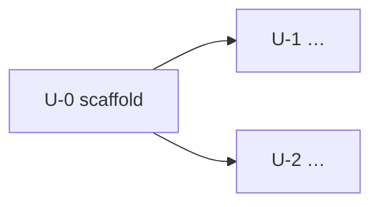

# Delivery Plan: <product name>

> Stage NP7 · Status: DRAFT | APPROVED <date-time> · Inputs: business plan (roadmap), requirements, architecture

## 1. Summary
- <number of units, milestones, first release target>

## 2. Milestones
| Milestone | Scope (units) | Target date | Exit criteria |
|---|---|---|---|
| M1 MVP | | | |

## 3. Units of work
A unit is a vertical slice (UI → logic → data) that a user can see working. Each unit becomes one work item.

| ID | Unit | Stories | Depends on | Size (S/M/L) | Milestone | Work item |
|---|---|---|---|---|---|---|
| U-0 | Project scaffold (core, config, routing, network, theme) | — | — | M | M1 | 001-setup-project-scaffold |
| U-1 | | | U-0 | | | 002-feature-… |

## 4. Build order

## 5. Definition of done (every unit)
See `.agents/rules/10-quality-gates.md` §5: tasks done, review and gap analysis, verification passed,
completion report, feature registry updated.

## 6. Traceability
| Business goal / KPI | FR | User story | Unit | Work item | Tests (filled during construction) |
|---|---|---|---|---|---|

## 7. Schedule risks
| Risk | Impact | Mitigation |
|---|---|---|

---
**Ready to approve?** ☐ every Must story is in a unit ☐ dependencies have no cycles ☐ milestones have exit
criteria ☐ the scaffold is first ☐ traceability is complete up to the work item
