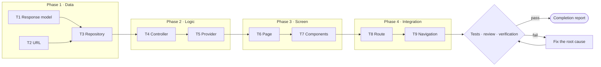
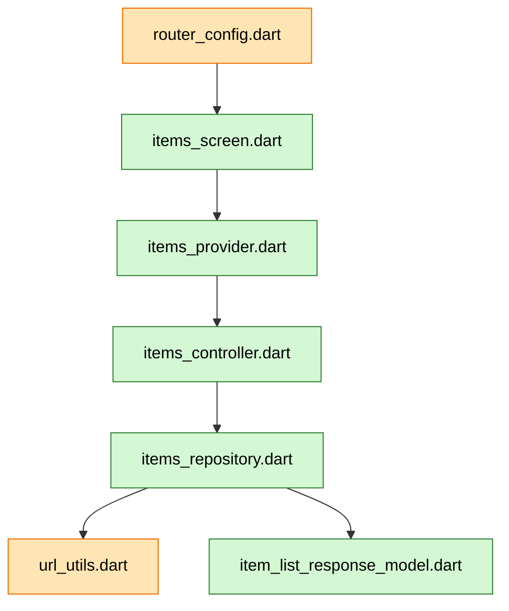
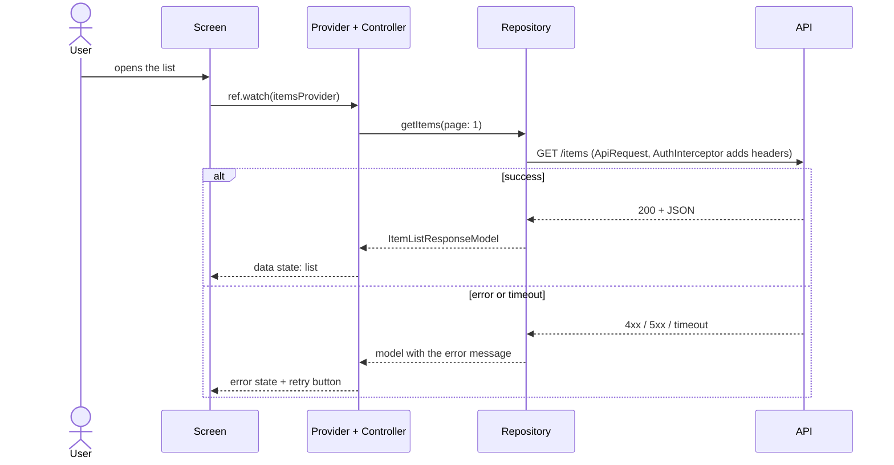

# Implementation Plan: <work item id> · <title>

> Status: DRAFT | APPROVED <date-time> | COMPLETED <date-time>
> Type: feature | change | setup · Covers: US-…, FR-… · Requirements: `<path>` · Integration plan: `<path>`
> 🛑 No code is written until the user explicitly approves this plan ("approve", "proceed", "go ahead", "do it",
> or a plain "yes" / "ok" reply to the gate card).
> Examples below use the Flutter house standard. Use your project's standard and paths.
<!-- Light plan (light mode: about 5 files or fewer, no new API, package or data change): this is the only document
     and the only gate. §1 also holds the user stories with acceptance criteria, §2 the integration points; one
     diagram (6c when behaviour changes, otherwise 6b); §7–11 and §13 take a line or two each; §12 and §14 stay
     complete (a one-line "How · Why · Check" per task is fine). -->

## Thinking summary
<!-- From .agents/skills/aidlc-think/SKILL.md. Keep it short. -->
- Depth: full | light (reason)
- Lessons applied: <ID (how)> · not applicable: <ID (why)>
- Research: <R-ID (topic)> | not needed (reason)
- Options: A … (score) · B … (score) → chosen: …, because …
- Pre-mortem: 1) <risk> → <mitigation> 2) …
- Self-review changes: …
- Verification: <n> facts verified · <n> assumptions (listed at the gate) · 0 unknown · verify-plan.sh ✓

## Facts and assumptions
<!-- Anti-hallucination (.agents/rules/50-anti-hallucination.md): every fact this plan depends on, with the
     evidence you saw in this session (path:line, command output, URL, the user's words).
     Status: verified · assumption (listed at the gate) · unknown (find it or ask the user before the gate).
     `bash ~/.aidlc-kit/verify-plan.sh <this file>` checks this table. -->
| # | Claim the plan depends on | Evidence | Status |
|---|---|---|---|
| F1 | <e.g. `ItemsRepository.getItems({page})` exists> | <`lib/features/items/repository/items_repository.dart:14`> | <verified> |

## 1. Objective
What is being implemented and why (2–4 sentences). What is NOT included.
Light plan: then the user stories with Given/When/Then acceptance criteria, error and empty cases included.

## 2. Scope analysis
Existing files, classes and modules affected, found by reading the code:
| Path | Why it is affected |
|---|---|
Existing features touched: …

<!-- aidlc:files:begin · only files listed in the two tables below may be changed after approval. Only the Path column counts: one or more full paths in backticks per row. Backticks in other columns never add files. -->
## 3. Files to create
| # | Path | Purpose | Covers |
|---|---|---|---|
| C1 | `lib/features/<feature>/controller/<feature>_controller.dart` | Business logic; extends BaseController | US-1 |

## 4. Files to modify
| # | Path | What changes | Covers |
|---|---|---|---|
| M1 | `lib/core/config/router_config.dart` | Add route constant, GoRoute and RouterPath entry | US-1 |
<!-- aidlc:files:end -->

## 5. Classes and methods affected
| Class | Method / member | New or changed | Purpose |
|---|---|---|---|

## 6. Diagrams: how the plan works
<!-- Three diagrams (a light plan: one), drawn from this plan's real tasks and files (examples below). Keep them in step with the
     Files tables and the task plan; a plan change updates them. -->

**6a. Plan flow:** the order of the tasks, what each one needs, the checks and where it ends.

**6b. File map:** new files (green), changed files (orange) and how they connect.

**6c. Runtime flow:** what happens when the user uses the feature, including the error path.

## 7. API changes
| Method | Endpoint (URL constant name) | Request model | Response model | Error cases |
|---|---|---|---|---|
Or: "None".

## 8. Routing changes
| Route constant | Path | Screen | Data passed (extra) | Navigated from |
|---|---|---|---|---|
Or: "None".

## 9. Dependencies
| Package | Version constraint | Why | Alternatives considered |
|---|---|---|---|
Commands that change files (generators, installers), e.g. `flutter pub add <pkg>`, `dart run build_runner build --delete-conflicting-outputs`:
- … or "None".

## 10. Risk assessment
| Risk | Impact | Mitigation / what to test carefully |
|---|---|---|

## 11. Rollback plan
How to undo this change (revert the commit; remove the route; reverse a data migration; turn off a flag).

## 12. Test plan
Every user story (US-n) and every NFR-n has a row here, or §13 names its check (`verify-plan.sh` traces them).
| Test file | Type (unit · widget · integration · end-to-end) | What it proves | AC · NFR |
|---|---|---|---|

## 13. Verification
Commands from `aidlc-docs/project-profile.md` → "Verification commands". Pass criteria: zero errors, no new
warnings or lint issues compared with the baseline, all tests pass, build succeeds.
**End-to-end check:** how the user-visible flow is proven (an integration test, or running the app with
screenshots) and the stories it covers; its output is the evidence in `test-report.md`.

## 14. Task plan
<!-- Live status (00-aidlc-core §7): ⏳ [PENDING] → 🔄 [IN PROGRESS] → ✅ [COMPLETED]; ⛔ [BLOCKED]; ⏭️ [SKIPPED] -->
<!-- Under every task: How (the approach: file, change, key code shape), Why (the requirement, standard section
     or lesson behind it), Check (how you will know it works). Three short lines; the examples show the level.
     Logic tasks (models, repositories, controllers, notifiers, utilities) are built test first (construction C2). -->
### Phase 1: Data layer
- [ ] ⏳ **[PENDING]** T1 Create response model `lib/features/items/model/response/item_list_response_model.dart`
  - How: `fromJson`/`toJson` for the JSON sample in §7, nullable fields, the JSON sample comment on top
  - Why: the repository returns typed data (architecture standard §7)
  - Check: a unit test parses the sample JSON, including an empty list
- [ ] ⏳ **[PENDING]** T2 Add the URL to `lib/core/config/network/url_utils.dart`
  - How: one constant `itemsUrl` next to the other feature URLs
  - Why: URLs live in one place (standard §9)
  - Check: analyzer clean; the repository test uses the constant
- [ ] ⏳ **[PENDING]** T3 Create repository `lib/features/items/repository/items_repository.dart`
  - How: one method per endpoint with `ApiRequest.send`; errors become a model with the message
  - Why: no try/catch in controllers; the interceptor adds the headers (standard §9)
  - Check: a repository test with `FakeAdapter`: 200 → data, 500 → error model

### Phase 2: Business logic layer
- [ ] ⏳ **[PENDING]** T4 Create controller
  - How: … · Why: … · Check: …
- [ ] ⏳ **[PENDING]** T5 Create provider(s)
  - How: … · Why: … · Check: …

### Phase 3: Presentation layer
- [ ] ⏳ **[PENDING]** T6 Create screen (page): scaffolding and composition only
  - How: … · Why: … · Check: …
- [ ] ⏳ **[PENDING]** T7 Create component(s)
  - How: … · Why: … · Check: …

### Phase 4: Integration
- [ ] ⏳ **[PENDING]** T8 Add the route and RouterPath entry
  - How: … · Why: … · Check: …
- [ ] ⏳ **[PENDING]** T9 Wire navigation from the calling screen
  - How: … · Why: … · Check: …

### Phase 5: Tests and verification
- [ ] ⏳ **[PENDING]** Remaining tests from the test plan (widget, integration, end-to-end)
- [ ] ⏳ **[PENDING]** Review and gap analysis (`10-quality-gates.md` §3)
- [ ] ⏳ **[PENDING]** Verification: analyzer, tests, build (`10-quality-gates.md` §4)
- [ ] ⏳ **[PENDING]** Completion report and knowledge retention

## 15. Plan changes (after approval)
| ID | Date-time | File and change | Reason | Status (proposed · approved · rejected) |
|---|---|---|---|---|

---
**Ready to approve?** (agent self-check before the gate)
☐ every file has a full path, a purpose and what it covers ☐ every acceptance criterion has a test in §12
☐ no dependency or file-changing command outside §9 ☐ the project still compiles after each phase
☐ risks and rollback are concrete ☐ no [OPEN-BLOCKING] question left ☐ Thinking summary filled
☐ the template's example rows are replaced by real ones ☐ every task has How, Why and Check
☐ the diagrams (three; a light plan: one) show this plan's real tasks and files and match the tables
☐ every story and NFR is traced (§12, §13) ☐ the end-to-end check is named
☐ no fact is "unknown" (ask the user instead) ☐ `verify-plan.sh` shows no ✗
