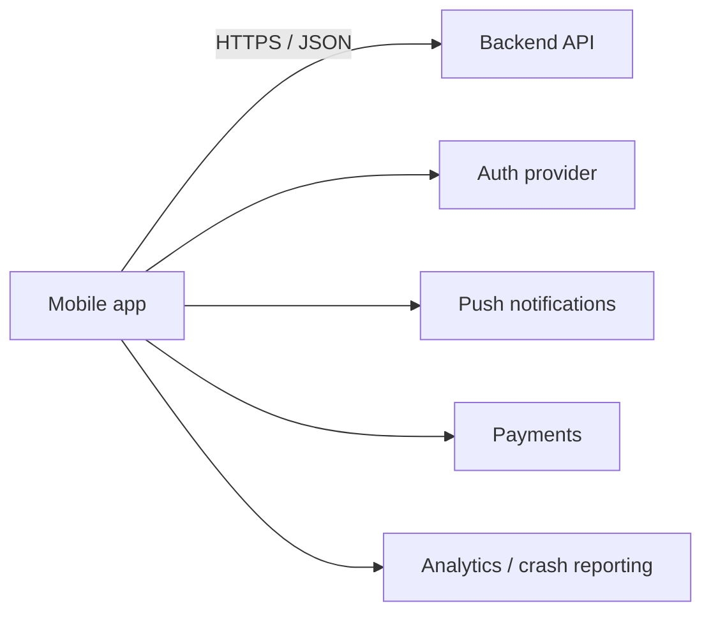
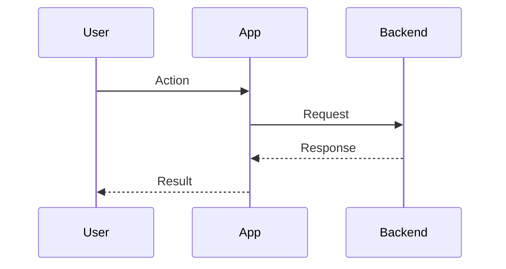
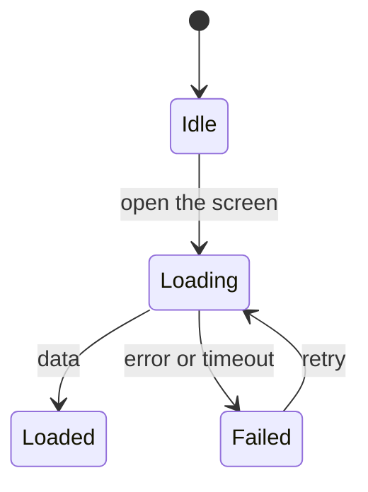

# Integration Plan: <product or feature>

> Stage NP5 / F3 · Status: DRAFT | APPROVED <date-time> · Work item: <id> · Inputs: requirements, `questions.md`
> New project: fill sections 1–6 and 8–10 (section 7 when an app already exists).
> Feature in an existing app: section 7 is the most important; fill 3–5 for every external call it makes;
> at full depth also §11 Design (a new project designs in `05-architecture.md`).

## 1. Summary
- <which systems connect, the riskiest integration, mock-first or not>

## 2. System context

## 3. Integration inventory
| ID | System / service | Purpose | Package / SDK (version) | Auth method | Environments | Data exchanged | Owner | Cost | Status |
|---|---|---|---|---|---|---|---|---|---|
| INT-1 | | | | | dev · staging · prod | | | | ready · in progress · missing |

## 4. Integration specifications
### INT-1: <name>
- **Purpose / stories:** US-…
- **Setup:** console configuration, app registration, files (e.g. `google-services.json`, `GoogleService-Info.plist`)
- **Config and secrets:** where each value lives (`--dart-define-from-file`, CI secret, env file). Never in code.
- **Contract:**

| Method | Endpoint / SDK call | Request (example JSON) | Response (example JSON) | Errors (code → meaning) |
|---|---|---|---|---|

- **Error handling:** timeouts, retries (how many, backoff), offline behaviour, message shown to the user,
  401 → session expired flow
- **Limits:** rate limits, quotas, payload sizes, cost per call
- **Testing:** sandbox / test accounts / mock server / fake repository
- **Monitoring:** logs, crash reporting, alerts

## 5. Key flows

## 6. Environments
| Item | dev | staging | prod |
|---|---|---|---|
| API base URL | | | |
| Firebase / backend project | | | |
| Keys and secrets location | | | |
| Payments | sandbox | sandbox | live |

## 7. Internal integration (existing app)
| Area | File / class (path) | Change | Risk |
|---|---|---|---|
| Navigation entry point | | | |
| Routes | | | |
| Providers / global state | | | |
| Shared widgets / components | | | |
| Core config (URLs, colors, constants) | | | |
| Platform files (AndroidManifest.xml, Info.plist, entitlements) | | | |
| Analytics events | | | |
| Localization | | | |
| Local data (schema change or migration) | | | |
- Backward compatibility: existing users' data, API versions, feature flag.

## 8. Order and dependencies
1. <what must exist first> → 2. … (mock-first if the backend is not ready: typed models + fake repository)

## 9. Risks and fallbacks
| Risk | Impact | Fallback |
|---|---|---|

## 10. Open items
- …

## 11. Design (full depth)
### 11.1 Data model
| Entity | Fields (type) | Relations | Stored where (API · local database · preferences) | Migration and its rollback |
|---|---|---|---|---|

### 11.2 States and flows
Multi-step or asynchronous flows (loading, sync, payment, upload) as a state diagram:

### 11.3 How each NFR is met and verified
| NFR | Design decision | Verified by (test · measurement · manual check) |
|---|---|---|

### 11.4 Compatibility and rollout
- Old app versions against the new backend · data migration and its rollback · feature flag · staged rollout

---
**Ready to approve?** ☐ every external call has a contract, error handling and a test approach ☐ no secret
in code ☐ environments defined ☐ internal touch points listed with paths ☐ no [OPEN-BLOCKING] item
☐ full depth: §11 filled (data model, states, a check for every NFR, rollout)
